# UI stack and screens

## Decision

**Tauri 2 + Vue 3 + Tailwind CSS v4 + shadcn-vue** ([ADR-0003](adr/0003-tauri-vue-shadcn-vue.md)).

| Concern | Library | Why |
|---|---|---|
| Framework | Vue 3 (Composition API, `<script setup lang="ts">`), Vite | Lightweight, approachable for contributors, first-class Tauri template |
| Components | [shadcn-vue](https://www.shadcn-vue.com) on [Reka UI](https://reka-ui.com) | Accessible, unstyled primitives; components are copied into the repo, so there is no lock-in |
| Styling | Tailwind CSS v4 with CSS variables | Theming through tokens, dark/light for free |
| Icons | [`@lucide/vue`](https://lucide.dev) | Default icon set of shadcn-vue |
| Routing | Vue Router (memory history) | Desktop app, no URL bar |
| UI state | Pinia | Official Vue store |
| Service data | `@tanstack/vue-query` | Caching and invalidation of IPC data; refetch on service events |
| Forms | VeeValidate + Zod (shadcn-vue `Form`) | Same schema validates input and documents shape |
| Charts | shadcn-vue `Chart` (Unovis) | History screen |
| Toasts | shadcn-vue `Sonner` (`vue-sonner`) | In-app feedback |
| Utilities | VueUse | Timers, media queries, focus management |
| i18n | `vue-i18n` | `en` and `es` from day one |
| Tests | Vitest + Vue Test Utils | Component and composable tests |
| Fonts | Geist and Geist Mono (bundled, OFL) | Tabular figures for the timer; no network fetch at runtime |

### shadcn-vue components used

`button`, `card`, `input`, `label`, `switch`, `select`, `dialog`, `alert-dialog`, `tabs`, `badge`, `separator`, `tooltip`, `sonner`, `scroll-area`, `dropdown-menu`, `command`, `form`, `number-field`, `chart`, `sidebar`.

### Custom components (the only ones designed from scratch)

| Component | Built from |
|---|---|
| `TimerRing.vue` | SVG `stroke-dasharray`, CSS transition |
| `PhaseBadge.vue` | `Badge` with one variant per phase |
| `TargetRow.vue` | Row for a site or app: icon, pattern/executable, kind, remove action |
| `StrictLockBanner.vue` | `Card` + lock icon |
| Block page | Plain HTML/CSS in the extension, same tokens |

### Frontend layout (`apps/desktop/src`)

```
src/
├── main.ts
├── App.vue
├── router/                 # routes: timer, session, blocklists, history, settings
├── pages/                  # one SFC per route: TimerPage.vue, BlocklistsPage.vue, …
├── components/
│   ├── ui/                 # generated by shadcn-vue CLI
│   └── …                   # domain components (TimerRing.vue, TargetRow.vue, …)
├── composables/            # useEngineState, useBlocklists, useSettings, useCountdown
├── stores/                 # Pinia stores (UI state only)
├── services/ipc.ts         # typed wrappers around Tauri `invoke` + event listeners
├── locales/                # en.json, es.json
└── styles/tokens.css       # design tokens (below)
```

IPC types are generated from the Rust `bastion-ipc` crate with [`specta`](https://github.com/specta-rs/specta) / `tauri-specta`, so the frontend never hand-writes message shapes.

## Design tokens

| Token | Light | Dark | Use |
|---|---|---|---|
| `--background` | `#FAFAF9` | `#0C0C0E` | App background |
| `--card` | `#FFFFFF` | `#16161A` | Cards |
| `--foreground` | `#18181B` | `#F4F4F5` | Text |
| `--muted-foreground` | `#71717A` | `#A1A1AA` | Secondary text |
| `--primary` (focus) | `#E5484D` | `#F2555A` | Focus phase, primary action |
| `--break` | `#12A594` | `#1FC7B1` | Break phases, healthy status |
| `--strict` | `#F5A524` | `#F7B955` | Strict mode, lock |
| `--border` | `#E4E4E7` | `#27272A` | Borders |
| `--radius` | `0.75rem` | | Base radius; the radius scale below is offsets from it |

Text on `--primary` and `--strict` fills uses dark text (`#18181B`) to meet 4.5:1 contrast.

The radius scale (`rounded-sm` … `rounded-4xl`, defined in `apps/desktop/src/styles/main.css`) is fixed offsets from `--radius`, so every corner follows the one base value. The generated shadcn-vue components choose the step; these are the sizes they get:

| Step | Value | Size | Used by |
|---|---|---|---|
| `sm` | `--radius` − 8px | 4px | Command palette items, kbd |
| `md` | `--radius` − 6px | 6px | Menu and select items, tab triggers, tooltips, small (`xs`, `sm`) buttons |
| `lg` | `--radius` − 4px | 8px | Inputs, textareas, buttons, the select trigger, the tab list, dropdown and select menus |
| `xl` | `--radius` | 12px | Cards, dialogs, alert dialogs, the command palette |
| `2xl` | `--radius` + 2px | 14px | No visible corner (toasts carry the class, but see below) |
| `3xl` | `--radius` + 4px | 16px | No current component |
| `4xl` | `--radius` + 8px | 20px | Badges, which stay pills (the radius is at least half their height) |

Toasts are 12px like cards: `Sonner.vue` gives them the `rounded-2xl` class, but vue-sonner's own rule sets their radius to `--border-radius`, which `Sonner.vue` sets to `var(--radius)`. Switches and scrollbars are pills (`rounded-full`); sheets sit against a window edge and keep square corners.

## Window

- Default 960 × 640, minimum 780 × 560.
- Custom title bar (`decorations: false`) with accessible window controls.
- Fixed 220 px sidebar: Timer, Blocklists, History, Settings; service and extension status at the bottom.
- Theme follows the OS, overridable in Settings.

## MVP screens

1. **Timer (idle)** — ring, preset, active blocklist, strict toggle, Start.
2. **Strict confirmation** — `alert-dialog` with summary and end time.
3. **Active session** — remaining time, phase, cycle, lock banner, disabled Stop with explanation, blocks this session.
4. **Blocklists** — master/detail with Sites / Apps / Exceptions tabs.
5. **Add application** — `command` search over installed and running apps.
6. **History** — focus sessions per day, most-attempted targets.
7. **Settings** — durations, cycles, behavior, browsers, service status.
8. **Block page** (extension) — blocked site, remaining time.
9. **Tray menu** — remaining time and quick actions.

### Mockup images

The visual reference for these screens is the images below, exported from the MVP mockup, in dark theme and with Spanish text. When this document and the images disagree on visuals, the images win, with these exceptions: the product name is Keitora (the images still show the old name, Bastion); the radius scale above applies, not the corner sizes in the images; and on the Sites tab, the "keep blocking during breaks" block must stay inside the card (the image shows an overflow inherited from the mockup, not intended design). The color tokens above are the same values the images use. Source canvas (private to the maintainer): [MVP mockup](https://claude.ai/artifact/6ieEt3wWHpio293sGTdGwC).

**1. Timer (idle)**

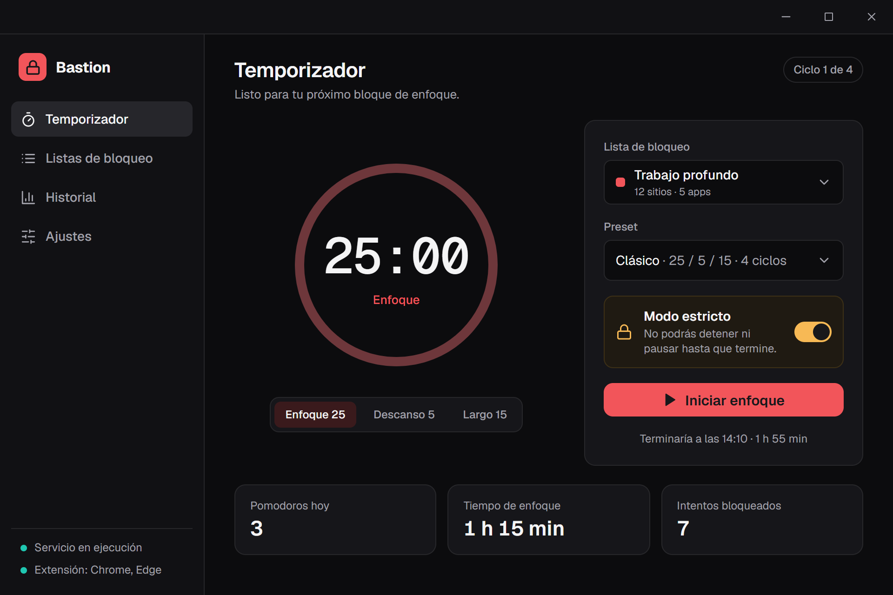

**2. Strict confirmation**

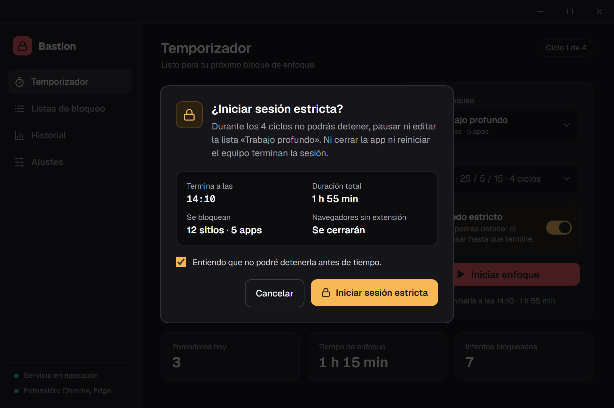

**3. Active session**

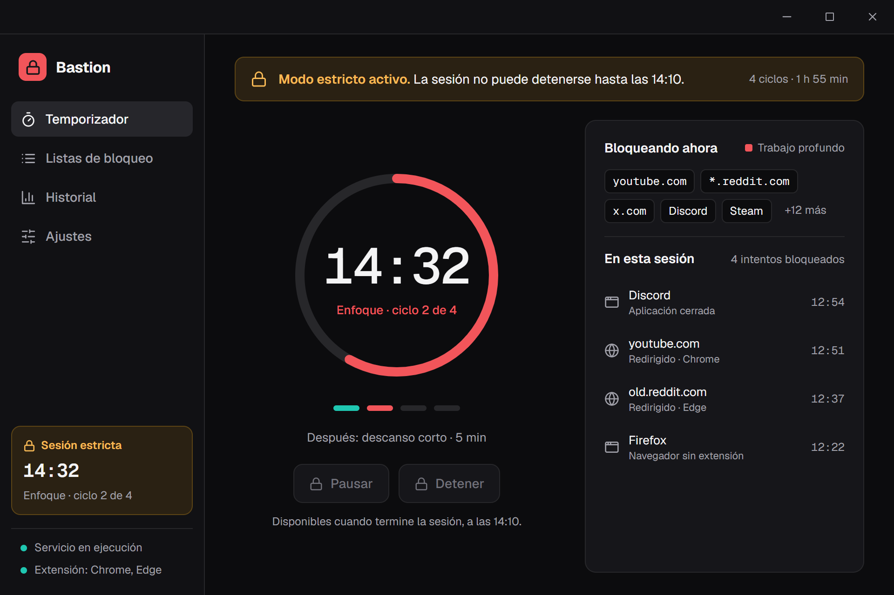

**4. Blocklists**

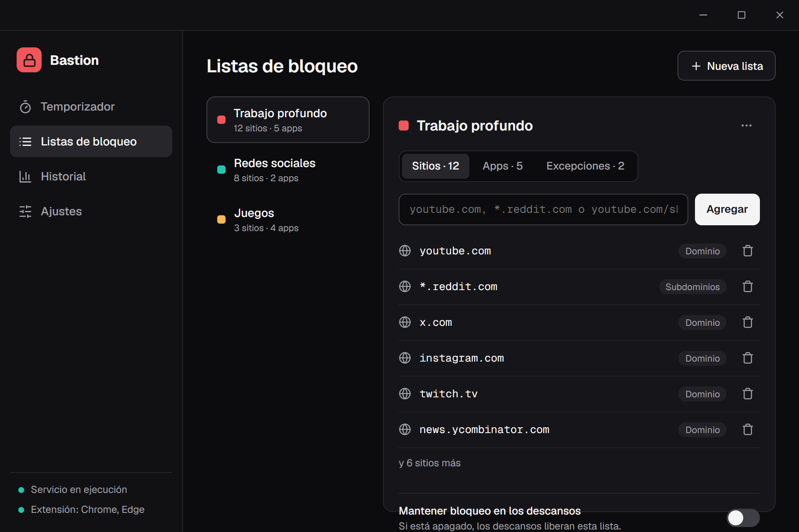

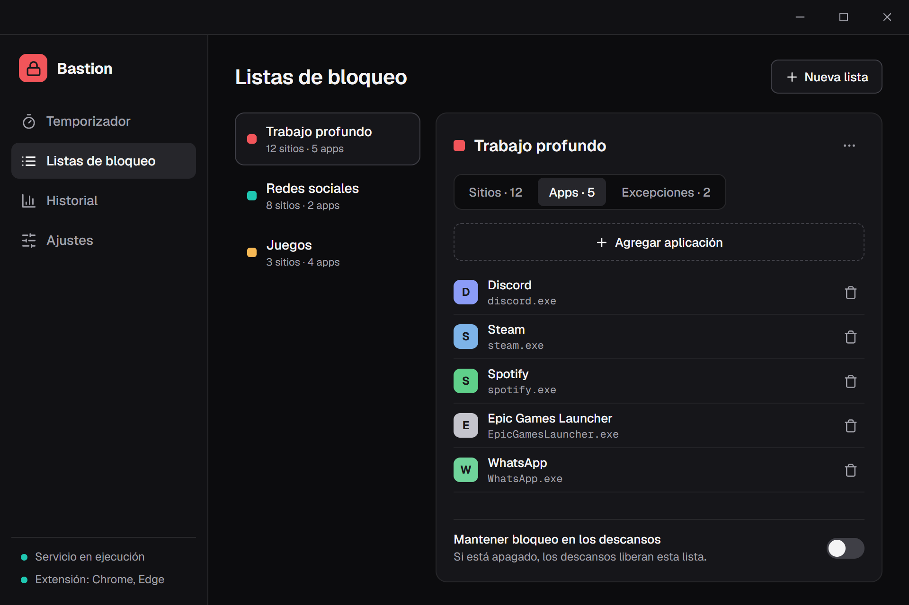

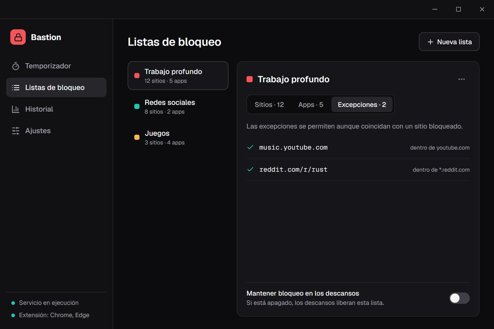

**5. Add application**

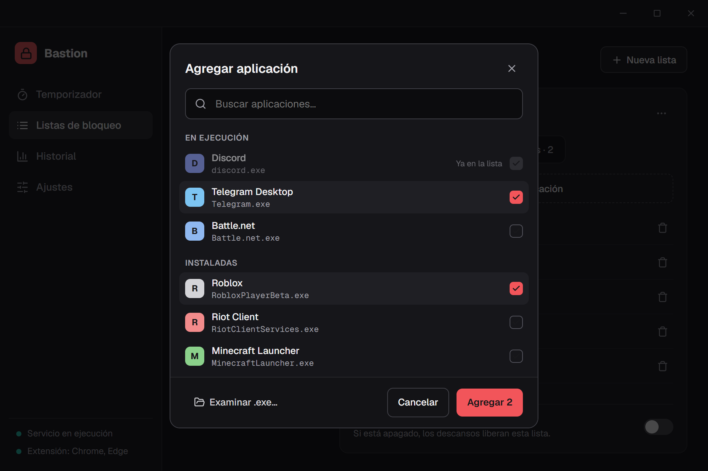

**6. History**

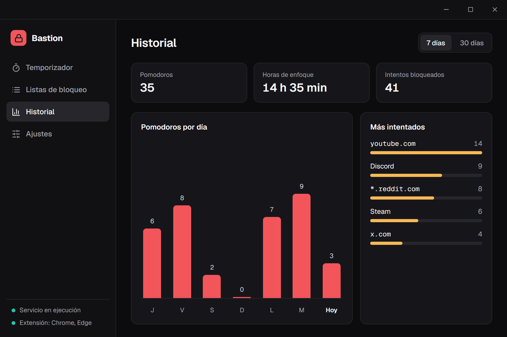

**7. Settings**

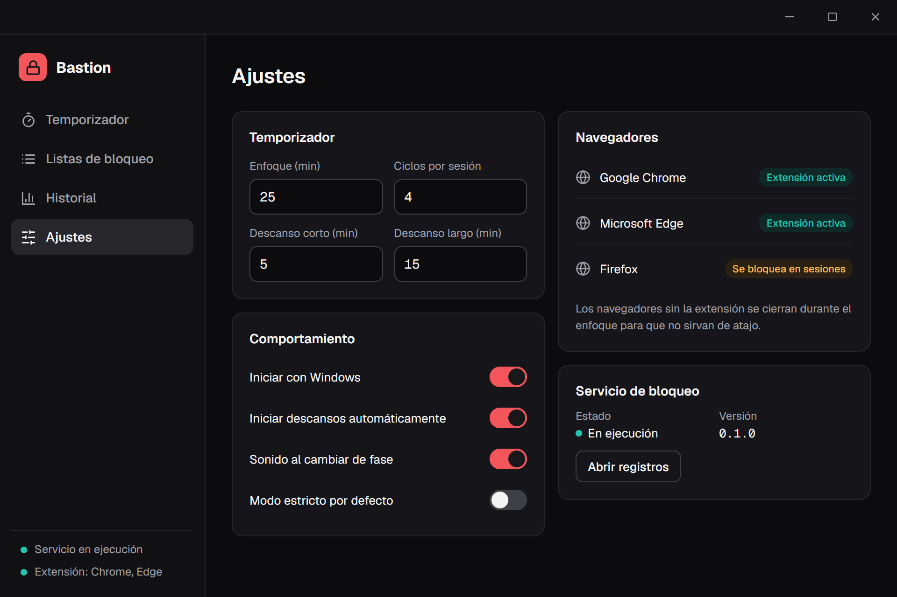

**8. Block page (extension)**

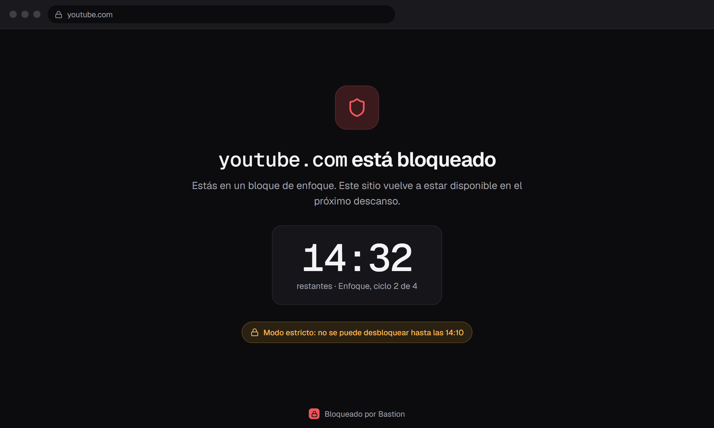

**9. Tray menu**

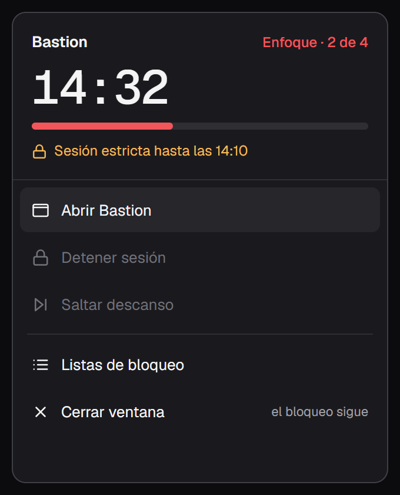
